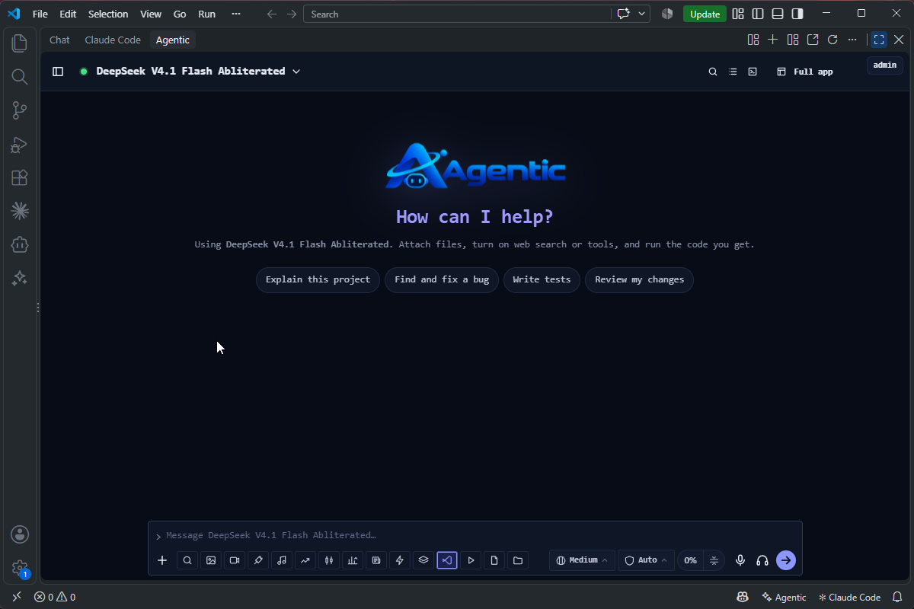
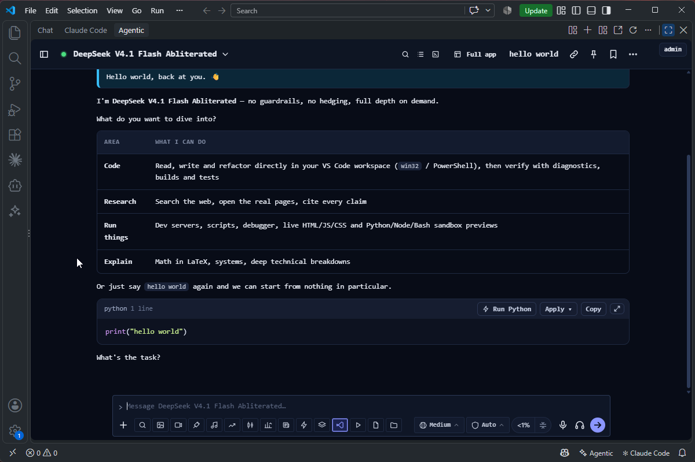
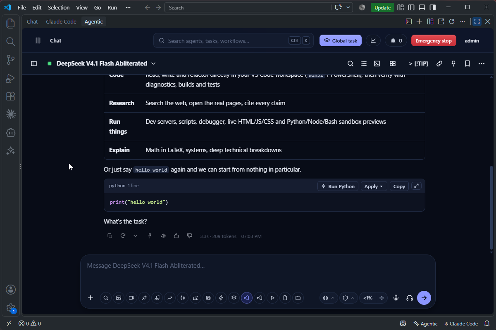

<div align="center">


**Agentic for VS Code: your Agentic server's chat inside VS Code, with tools that read, edit and run code in your workspace.**


[Install](#install) · [Screenshots](#screenshots) · [Features](#features) · [MCP servers](#mcp-servers) · [Settings](#settings) · [Setup guide](SETUP.md) · [Agentic server](https://github.com/smurflabs/Agentic)

</div>

---

## What is it?

Agentic for VS Code brings the chat of your [Agentic server](https://github.com/smurflabs/Agentic) into the editor. It is the same app as in the browser and the desktop app, with the same models, conversations and settings. The model gets tools that work through VS Code itself: its edits show in the editor and can be undone, it sees the Problems panel, and it runs commands in your workspace with your approval.

The extension runs a small local server on `127.0.0.1`. That server forwards requests to your Agentic server and adds your API key, so the page never sees the key.

## Screenshots

<table>
  <tr>
    <td width="50%" valign="top">
      <br>
      <sub><b>Lite mode</b>: just the chat, next to VS Code's own Chat and Claude Code.</sub>
    </td>
    <td width="50%" valign="top">
      <br>
      <sub><b>Code blocks</b>: Run, Apply to a file, or Copy.</sub>
    </td>
  </tr>
  <tr>
    <td colspan="2" valign="top">
      <br>
      <sub><b>Full app</b>: every page of the web app inside VS Code.</sub>
    </td>
  </tr>
</table>

## Features

### The full Agentic chat

- **Chat with every model your account may use,** including custom models. Goals, plan mode, reasoning effort, web search, knowledge bases, attachments, images, saved prompts and slash commands all work here.
- **Two views:** **Full app** has every page of the web app, and **Lite mode** shows only the chat, like Claude Code.
- **Multitask:** up to four chats side by side, all live at once.
- **Always current:** history and live answers stay in step with the web and desktop apps.

### Tools that work through VS Code

- **Read and search** the workspace, including unsaved changes in open editors.
- **Edits go through VS Code,** so they show in the editor and Ctrl+Z undoes them. You can review an edit before it is applied.
- **Problems panel:** the model reads VS Code's diagnostics to check its own work.
- **Editor context:** the active file, the selection and the open editors ("explain *this*").
- **Commands** in the workspace, in PowerShell or bash.
- **Local MCP servers,** including the ones you set up for VS Code or Claude Code, with sign-in for hosted servers.
- **Approvals:** changes and commands follow the chat's permission mode, and paths outside the workspace are refused.
- **Use from other windows:** while VS Code is open, chats in the web and desktop apps can use this workspace's tools.

### Editor commands

- **Ask About Selection** (Ctrl+Alt+L), **Explain This Code**, **Fix This Code** and **Fix This Problem**, with the problems VS Code reports for that code.
- **Review This File**, **Fix Problems in This File** and **Add File to Chat**, from the editor, its tabs or the Explorer.
- **Open the chat** with Ctrl+Alt+A, or in an editor tab.

### Run, preview and share

- **Run Project…** finds how each workspace folder runs: `.agentic/launch.json` or `.claude/launch.json`, or what the project shows (npm scripts, static sites, Python, .NET, Go, Rust, Makefiles).
- **Runs in a terminal:** each run gets its own terminal tab, and web apps open in the Simple Browser beside the chat.
- **Artifacts:** projects and chat pages can be shared as public links.

### And more

- **Voice:** answers read aloud and hands-free Dictation mode with the server's voices. The extension records the microphone itself.
- **Media tabs:** Images, Music and Audio open the server's media tabs in an editor tab.
- **Agentic CLI link:** the CLI's `/ide` sends your selection, shows its edits as diffs here and reads the Problems panel.
- **Keyboard shortcuts:** change the chat's keys and VS Code's keys for Agentic in one place.
- **Updates:** the extension installs new versions from your Agentic server.

## MCP servers

The chat in VS Code gets [MCP](https://modelcontextprotocol.io) tools from the Agentic server, from VS Code, and from the MCP servers you already use.

### Ready without any setup

- **Your Agentic server's MCP servers.** These are the server's [16 built-in tool servers](https://github.com/smurflabs/Agentic#built-in-tool-servers) (storage, git, documents, database, data, files, code review, network checks, utilities and more), plus the servers you or your administrator added under **My MCP servers**. Turn them on in the chat's **Tools** menu. They run on the server, and you can use only the ones your account may use.
- **VS Code's own tools.** These are built into the extension: the workspace tools, plus definitions, references and symbols from the language servers (`agentic.tools.ideTools`). Tools that other VS Code extensions offer to language models are also included (`agentic.tools.vscodeTools`).
- **The MCP servers you already set up.** These are read live, with nothing to import:
  - **Agentic:** `~/.agentic/mcp.json` (shared with the CLI), and the project's `.mcp.json` and `.agentic/mcp.json`.
  - **Claude Code:** `~/.claude.json` (your servers and this project's), your plugins' servers, and Claude Desktop's servers (`agentic.mcp.includeClaude`).
  - **VS Code:** `.vscode/mcp.json`, your user `mcp.json` and the `mcp` setting (`agentic.mcp.includeVsCode`). `${input:…}` values are asked for once and kept in VS Code's secret storage.
- **The Agentic CLI link.** The CLI's `/ide` command connects to this window (`agentic.ide.bridge`).

A project's servers (its `.mcp.json` or `.vscode/mcp.json`) start only after you allow them once, so a cloned repository can't run programs by itself.

### Add your own

**Agentic: Add MCP Server…** and **Agentic: MCP Servers: Add, Allow and Sign In** open the MCP page. It lists every server with its status and tools, and from there you can:
- add a server from the catalog below, or by hand (a program over stdio, a Streamable HTTP URL or an SSE URL)
- allow a project's servers
- sign in to hosted servers that use OAuth
- switch servers on and off

Other ways to add one:
- **Install on my computer:** on the web app's **My MCP servers** page, this sends a server to this VS Code window, and its form opens filled in.
- **Edit the files directly:** any of the files above, in Claude Code's layout or VS Code's. Values can use `${VAR}`, `${VAR:-default}`, `${env:VAR}`, `${workspaceFolder}` and `${userHome}`.

```json
{ "mcpServers": {
    "files":  { "command": "npx", "args": ["-y", "@modelcontextprotocol/server-filesystem", "${workspaceFolder}"] },
    "remote": { "type": "http", "url": "https://example.com/mcp", "headers": { "Authorization": "Bearer ${env:MY_TOKEN}" } } } }
```

**The catalog.** The same 21 well-known servers as in the web app, the desktop app and the CLI:

| Server | What it does | Needs |
|---|---|---|
| Filesystem | Read, search and edit files in the folders you allow | Node.js |
| Git | Read a Git repository: status, diffs, log, branches and commits | uv (Python) |
| GitHub | GitHub's official server: repositories, issues, pull requests, code search and Actions (hosted) | A GitHub token |
| Desktop Commander | Terminal commands, processes and file editing on the computer it runs on | Node.js |
| Playwright browser | Microsoft's browser automation: open pages, click, type, fill forms and read pages | Node.js 20+ |
| Chrome DevTools | Google's server for Chrome: drive the browser, read the console and network, record performance traces | Node.js 20.19+ and Chrome |
| Fetch | Download a web page and turn it into Markdown | uv (Python) |
| Firecrawl | Scrape, crawl and extract structured data from websites, including JavaScript-heavy ones | Node.js 22+ and a Firecrawl API key |
| Brave Search | Web, news, image and local search through Brave's own index | Node.js and a Brave Search API key |
| Tavily | Search built for AI agents, with page extraction and site crawling | Node.js and a Tavily API key |
| Exa | Neural web search: pages by meaning, research papers, companies and code | Node.js 20+ and an Exa API key |
| Context7 | Current documentation and code examples for thousands of libraries | Node.js 20+ |
| Microsoft Learn | Search and read Microsoft's documentation: .NET, Azure, Windows, Microsoft 365 (hosted) | Nothing |
| DeepWiki | Ask questions about any public GitHub repository and read its generated wiki (hosted) | Nothing |
| AWS Documentation | Search and read AWS documentation | uv (Python) |
| Notion | Search, read and update pages and databases in your Notion workspace | Node.js and a Notion integration token |
| Supabase | Query and manage Supabase projects: tables, SQL, migrations and logs (read-only by default) | Node.js and a Supabase access token |
| Memory | A knowledge graph the model stores facts in and recalls across sessions | Node.js |
| Sequential Thinking | Structured step-by-step reasoning that the model can revise and branch | Node.js |
| Time | The current time in any time zone, and conversions | uv (Python) |
| REA | Reverse engineering of native binaries, .NET assemblies, JS/Electron apps, Android APKs and websites | Node.js 22+; optionally Ghidra, Hopper or IDA |

While VS Code is open, chats in the web and desktop apps can use these servers too.

## Install

1. Download `agentic-vscode-<version>.vsix` from this repository's [Releases](https://github.com/smurflabs/Agentic_vscode/releases) or from **Apps & updates** in the Agentic web app.
2. Install it:

   ```text
   code --install-extension agentic-vscode-<version>.vsix
   ```

   You can also use the Extensions view: **…** → **Install from VSIX…**.
3. Run **Agentic: Sign In** and enter your server's address and an API key. To create the key, open the web app's user menu, then **API key** → **Generate**.

## Settings

| Setting | Default | What it does |
|---|---|---|
| `agentic.serverUrl` | (empty) | Your Agentic server |
| `agentic.chat.mode` | `full` | `full` (every page of the web app) or `lite` (chat only) |
| `agentic.tools.enabled` | `true` | Workspace tools for the model |
| `agentic.tools.allowCommands` | `true` | Let the model run shell commands |
| `agentic.tools.shell` | `auto` | Shell for commands: PowerShell on Windows, bash or sh elsewhere |
| `agentic.tools.commandTimeoutSeconds` | `120` | How long a command runs before it goes on in the background |
| `agentic.tools.ideTools` | `true` | Definitions, references and symbols from VS Code's language servers |
| `agentic.tools.wholeComputer` | `false` | Let the tools work on files outside the workspace |
| `agentic.tools.reviewEdits` | `true` | In Manual permission mode, show each change as a diff to accept or reject |
| `agentic.mcp.includeVsCode`, `agentic.mcp.includeClaude` | `true` | Also use the MCP servers set up for VS Code, Claude Code and Claude Desktop |
| `agentic.codeActions.enabled` | `true` | "Fix with Agentic" and "Explain with Agentic" in the light bulb menu |
| `agentic.ide.bridge` | `true` | Let the Agentic CLI's `/ide` connect to this workspace |
| `agentic.chat.sendSelectionCommandsImmediately` | `true` | Explain, Fix and Review send at once (off: fill the message box) |
| `agentic.chat.animations` | `calm` | `calm`, `full` or `off` |
| `agentic.speech.recorder` | (empty) | Dictation's recorder. Empty means PowerShell on Windows, or `parecord`, `arecord`, `sox` or `ffmpeg` elsewhere |
| `agentic.updates.enabled`, `agentic.updates.automatic` | `true` | Check the server for new versions, and install them without asking |

The `AGENTIC_SERVER` and `AGENTIC_API_KEY` environment variables also work, as in the Agentic CLI.

## Building

```text
npm ci
npm test                    # compile, then unit and proxy tests
npm run package             # agentic-vscode-<version>.vsix (Node.js 20 or later)
npm run test:integration    # real VS Code, isolated profile, temporary workspace
```

[SETUP.md](SETUP.md) covers development runs and releases.

## License

Agentic for VS Code is free software: you can redistribute it and/or modify it under the terms of the [GNU General Public License](LICENSE) as published by the Free Software Foundation, either version 3 of the License, or (at your option) any later version.
